# ⚔️ Labyrinthe Warhammer — Architecture Docker Cloud Microservices

Projet complet d'orchestration microservices conteneurisés sous Docker et Docker Compose. Ce document centralise l'architecture, la segmentation réseau étanche (DMZ), la persistance par volumes, la sécurisation des ports, la gestion du fichier unique d'environnement `.env` et le rapport de benchmark des ressources.

---

## 📑 Sommaire
1. [Schéma Global de l'Architecture](#1-schéma-global-de-larchitecture)
2. [Matrice des Services & Sécurité](#2-matrice-des-services--sécurité)
3. [Découpage Réseau & Sécurisation des Ports](#3-découpage-réseau--sécurisation-des-ports)
4. [Persistance des Données (Volumes Nommés)](#4-persistance-des-données-volumes-nommés)
5. [Gestion du .env Unique & Passage des Variables](#5-gestion-du-env-unique--passage-des-variables)
6. [Benchmarks & Quotas de Ressources (CPU / RAM)](#6-benchmarks--quotas-de-ressources-cpu--ram)
7. [Guide de Démarrage & Commandes de Validation](#7-guide-de-démarrage--commandes-de-validation)

---

## 1. Schéma Global de l'Architecture

```mermaid
flowchart TD
    subgraph HOST[" Machine Hôte (Localhost) "]
        BROWSER[" Client Web / Navigateur "]
        DEV[" Développeur / Tests API "]
        ENV_FILE[".env (Fichier unique de configuration)"]
    end

    subgraph DOCKER_ENGINE[" Moteur Docker (Docker Daemon) "]
        
        subgraph FRONT_NET[" Réseau DMZ : warhammer_frontend_net (Bridge) "]
            direction TB
            FRONT[" Conteneur Frontend (cloud_frontend)\nNginx Alpine\n• Port interne: 80\n• Reverse Proxy: /api -> backend:5000 "]
            BACK_PUB[" Interface Réseau Frontend du Backend "]
        end

        subgraph BACK_NET[" Réseau Interne Isolé : warhammer_backend_net (Bridge, internal: true) "]
            direction TB
            BACK_PRIV[" Interface Réseau Interne du Backend "]
            GAME_SRV[" Conteneur Game Server (cloud_game_server)\nPython 3.11 (Non-root 'appuser')\n• Port interne TCP: 9000\n• ❌ AUCUN port exposé sur l'hôte "]
        end

        subgraph BACKEND_SVC[" Conteneur Backend (cloud_backend) "]
            BACK_APP[" API Flask (Python 3.11 Alpine)\nLogique de jeu, Événements, Combat\nPasserelle vers le Game Server "]
        end

        subgraph VOLUMES[" Volumes Docker Nommés (Persistance) "]
            VOL_DATA[(" warhammer_backend_data \n(/app/data)\n• player_save.json ")]
            VOL_LOGS[(" warhammer_backend_logs \n(/app/logs)\n• backend.log ")]
            VOL_FRONT[(" warhammer_frontend_logs \n(/var/log/nginx)\n• access.log, error.log ")]
        end
    end

    %% Connexions Client vers Hôte
    BROWSER -->|"HTTP :8080"| FRONT
    DEV -.->|"HTTP 127.0.0.1:5000 (Optionnel Dev)"| BACKEND_SVC

    %% Injection variables .env unique
    ENV_FILE -.->|"env_file: .env"| FRONT
    ENV_FILE -.->|"env_file: .env"| BACKEND_SVC
    ENV_FILE -.->|"env_file: .env"| GAME_SRV

    %% Flux DMZ et Nginx Proxy
    FRONT -->|"Proxy HTTP interne (/api)"| BACKEND_SVC

    %% Flux Réseau Interne
    BACKEND_SVC -->|"Socket TCP interne (:9000)"| GAME_SRV

    %% Volumes
    BACKEND_SVC --- VOL_DATA
    BACKEND_SVC --- VOL_LOGS
    FRONT --- VOL_FRONT

    %% Styles
    classDef secure fill:#1a3a2a,stroke:#2ed573,stroke-width:2px;
    classDef dmz fill:#2c3e50,stroke:#3498db,stroke-width:2px;
    classDef storage fill:#3d2b1f,stroke:#f39c12,stroke-width:2px;
    class GAME_SRV secure;
    class FRONT dmz;
    class VOL_DATA,VOL_LOGS,VOL_FRONT storage;
```



---

## 2. Matrice des Services & Sécurité

| Service | Conteneur | Réseaux Attachés | Ports Hôte | Ports Internes | Volume Monté | Utilisateur Système |
| :--- | :--- | :--- | :--- | :--- | :--- | :--- |
| **frontend** | `cloud_frontend` | `warhammer_frontend_net` | `8080` (0.0.0.0) | `80` (HTTP) | `warhammer_frontend_logs` | `nginx` (non-root) |
| **backend** | `cloud_backend` | `warhammer_frontend_net`<br>`warhammer_backend_net` | `127.0.0.1:5000` | `5000` (HTTP) | `warhammer_backend_data`<br>`warhammer_backend_logs` | `root` (Alpine) |
| **game-server** | `cloud_game_server` | `warhammer_backend_net` | **Aucun** (0 port hôte) | `9000` (TCP) | Aucun | `appuser` (non-root) |

---

## 3. Découpage Réseau & Sécurisation des Ports

L'architecture applique le principe fondamental du **moindre privilège** et de la **segmentation multi-tiers (DMZ)** via deux réseaux distincts :

### A. Réseau `warhammer_frontend_net` (Tier Web / DMZ)
- **Rôle** : Servir l'interface web (HTML/CSS/JS) et servir de passerelle pour les appels API.
- **Conteneurs connectés** : `cloud_frontend` et `cloud_backend`.
- **Reverse Proxy Nginx** :
  - Nginx écoute sur le port public `8080:80`.
  - Toute requête vers `/api/*` est directement relayée en interne à `http://backend:5000/api/*`.
  - Grâce à ce reverse proxy, le port du backend n'a pas besoin d'être ouvert publiquement sur la machine hôte : il est restreint à `127.0.0.1:5000` (uniquement accessible en local pour tests), éliminant les risques d'exposition sur le réseau local.

### B. Réseau `warhammer_backend_net` (Tier Interne Sécurisé)
- **Rôle** : Isoler la communication sensible entre le backend Flask et le microservice `game-server`.
- **Option `internal: true`** : Ce réseau Docker n'a aucune passerelle vers l'extérieur. Aucun paquet provenant d'Internet ou du LAN ne peut l'atteindre, et les conteneurs qui y sont confinés ne peuvent pas initier de trafic vers l'extérieur.
- **Cloisonnement total du `game-server`** :
  - **Aucun port publié sur l'hôte** (`ports:` supprimé, seul `expose: 9000` est défini au niveau Docker).
  - Le conteneur frontend n'a **aucun accès physique ni de résolution DNS** vers le `game-server` (`wget: bad address 'game-server:9000'`).
  - Même en cas de compromission du serveur web Nginx, un attaquant ne peut pas pivoter vers le serveur de jeu. Seul le backend Flask peut initier des requêtes TCP vers `game-server:9000`.

---

## 4. Persistance des Données (Volumes Nommés)

Par défaut, les conteneurs sont éphémères (*stateless*). Trois volumes nommés garantissent la persistance et la traçabilité :

| Volume Nommé | Chemin dans le Conteneur | Rôle & Pertinence |
| :--- | :--- | :--- |
| `warhammer_backend_data` | `/app/data` | **Persistance de l'état du joueur et des parties** : Enregistrement de `player_save.json` lors de chaque action (sélection de héros, montée de niveau, butin, combat). La session est rechargée automatiquement au redémarrage du conteneur. Deux boutons (*Sauvegarder* et *Charger*) sont aussi présents dans l'interface web. |
| `warhammer_backend_logs` | `/app/logs` | **Traçabilité et audit applicatif** : Centralisation des journaux Flask (`backend.log`) conservés après l'arrêt ou la recréation des conteneurs. |
| `warhammer_frontend_logs` | `/var/log/nginx` | **Rétention des accès Web** : Conservation des fichiers de logs Nginx (`access.log`, `error.log`) pour l'analyse des requêtes HTTP. |

---

## 5. Gestion du .env Unique & Passage des Variables

Toutes les configurations de la pile sont centralisées dans un **unique fichier `.env`** situé à la racine du projet :

```env
# --- Ports exposés sur la machine hôte ---
FRONTEND_PORT=8080
BACKEND_PORT=5000
GAME_SERVER_PORT=9000

# --- Paramètres de l'application Flask (Backend) ---
ENVIRONMENT=production
DEBUG=False
FLASK_ENV=production
SECRET_KEY=warhammer_chaos_secret_key_2026
LOG_LEVEL=INFO
DATA_DIR=/app/data
LOG_DIR=/app/logs

# --- Configuration du Microservice Game Server interne ---
GAME_SERVER_HOST=game-server

# --- Quotas de Ressources Docker (Limites & Réservations) ---
FRONTEND_CPU_LIMIT=0.25
FRONTEND_MEM_LIMIT=128M
FRONTEND_CPU_RESERVE=0.05
FRONTEND_MEM_RESERVE=32M

BACKEND_CPU_LIMIT=0.50
BACKEND_MEM_LIMIT=256M
BACKEND_CPU_RESERVE=0.10
BACKEND_MEM_RESERVE=64M

GAME_SERVER_CPU_LIMIT=0.25
GAME_SERVER_MEM_LIMIT=128M
GAME_SERVER_CPU_RESERVE=0.05
GAME_SERVER_MEM_RESERVE=32M
```

- **Liaison dans Docker Compose** : Tous les services sont reliés à ce fichier unique via la directive `env_file: - .env`.
- **Substitution dynamique** : Les valeurs par défaut `${VARIABLE:-defaut}` sont préservées dans `docker-compose.yml` en repli de sécurité.
- **Consommation applicative** : Le code Python (`app.py`, `server.py`) lit dynamiquement ces paramètres via `os.getenv()`.

---

## 6. Benchmarks & Quotas de Ressources (CPU / RAM)

### A. Méthodologie du Test de Charge
Le benchmark a été exécuté via le script d'automatisation [`benchmark.py`](benchmark.py) :
- **Cible testée** : `http://localhost:8080/api` (traversée complète Nginx Reverse Proxy -> API Flask).
- **Charge appliquée** : 300 requêtes HTTP sous concurrence de 10 threads (`ThreadPoolExecutor`).
- **Collecte** : Horodatage précis avec `time.perf_counter()` et extraction en temps réel via `docker stats --no-stream`.

### B. Résultats des Mesures
| Métrique | Valeur Observée | Interprétation |
| :--- | :--- | :--- |
| **Taux de succès** | **100.0%** (300/300) | Aucune perte de paquet, aucun code d'erreur HTTP 5xx/4xx. |
| **Durée totale du test** | **2.15 secondes** | Exécution fluide et absorption immédiate de la charge. |
| **Débit moyen (Throughput)** | **139.40 req/s** | Capacité de traitement élevée pour une stack Python légère. |
| **Latence minimale** | **16.61 ms** | Temps de réponse optimal sans contention. |
| **Latence moyenne** | **69.36 ms** | Excellente réactivité pour un RPG au tour par tour. |
| **Latence p95 (95e percentile)**| **110.56 ms** | 95% des requêtes servies en moins de 111 ms. |
| **Latence maximale** | **295.98 ms** | Pic ponctuel lors du handshake TCP initial. |

### C. Empreinte Mémoire & CPU (Repos vs Charge)
| Conteneur | Service | RAM Repos (Idle) | RAM sous Charge | Utilisation RAM (%) | Limite Allouée (Plafond) | Réservation (Plancher) |
| :--- | :--- | :--- | :--- | :--- | :--- | :--- |
| `cloud_frontend` | Nginx Alpine | **10.32 MiB** | **10.88 MiB** | 8.50% | **128 MiB** | **32 MiB** |
| `cloud_backend` | Flask Python | **22.56 MiB** | **22.67 MiB** | 8.85% | **256 MiB** | **64 MiB** |
| `cloud_game_server` | Python TCP Socket | **5.84 MiB** | **5.82 MiB** | 4.55% | **128 MiB** | **32 MiB** |

### D. Justification Technique des Quotas
1. **Frontend (Nginx Alpine - Limite 128M / CPU 0.25)** :
   Nginx utilise une architecture événementielle asynchrone ultra-légère en C. Même à 140 req/s, sa RAM n'a varié que de 0.56 MiB (~10.8 MiB). Une limite de 128M offre une marge de sécurité de plus de 10x sans risque de saturation.
2. **Backend (Flask API - Limite 256M / CPU 0.50)** :
   L'interpréteur Python 3.11 avec Flask, le parsing JSON et la sérialisation des sauvegardes sur volume consomment environ 23 MiB. La limite à 256 MiB absorbe d'éventuels calculs complexes d'arbres de talents tout en protégeant le système de l'OOM Killer.
3. **Game Server (Socket TCP - Limite 128M / CPU 0.25)** :
   Le serveur utilise les sockets natives Python sans framework web externe. Son empreinte est inférieure à 6 MiB. Un quota de 128 MiB est amplement suffisant.

---

## 7. Guide de Démarrage & Commandes de Validation

### 1. Démarrer l'ensemble de la pile
```bash
docker compose up -d --build
```
L'application est immédiatement accessible dans le navigateur sur : **http://localhost:8080**

### 2. Vérifier l'état et la santé des 3 conteneurs
```bash
docker compose ps
```

### 3. Exécuter le benchmark de performance
```bash
python benchmark.py
```

### 4. Vérifier la persistance des volumes Docker
```bash
# Vérifier la présence des volumes nommés
docker volume ls

# Inspecter les fichiers sauvegardés dans le volume du backend
docker exec cloud_backend ls -la /app/data /app/logs
```

### 5. Tester l'étanchéité du réseau et l'isolation du port
```bash
# Test 1 : Vérifier que le Game Server est joignable depuis le backend (doit réussir)
docker exec cloud_backend python -c "import socket; s = socket.socket(); s.connect(('game-server', 9000)); print(s.recv(1024).decode())"

# Test 2 : Vérifier que le Frontend NE PEUT PAS joindre le Game Server (doit échouer)
docker exec cloud_frontend wget -T 2 -qO- http://game-server:9000

# Test 3 : Vérifier que le port 9000 n'est pas accessible depuis la machine hôte (doit échouer)
curl.exe --connect-timeout 2 http://localhost:9000
```

### 6. Arrêter la pile
```bash
docker compose down
```
*(Ajouter le drapeau `-v` si vous souhaitez également réinitialiser les volumes de données)*
