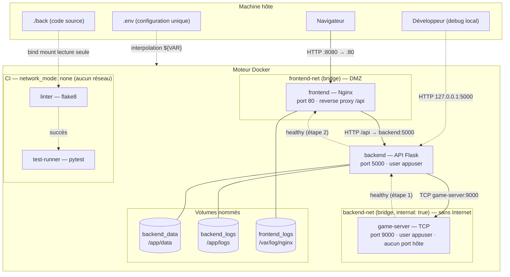

# ⚔️ Labyrinthe Warhammer — Architecture Docker Cloud Microservices

Projet d'orchestration de microservices sous Docker et Docker Compose : un jeu RPG web composé d'un **frontend** (Nginx), d'un **backend** (API Flask) et d'un **serveur de jeu** (TCP), accompagnés de deux conteneurs **CI** (lint et tests).

**Aucune image applicative de Docker Hub n'est utilisée** : les 5 images partent d'`alpine:3.20`, une base Linux nue de quelques Mo. Python, Flask, Nginx, flake8 et pytest y sont installés à la main avec le gestionnaire de paquets `apk`.

---

## 📑 Sommaire
1. [Démarrage rapide](#1-démarrage-rapide)
2. [Schéma de l'architecture et des communications](#2-schéma-de-larchitecture-et-des-communications)
3. [Les images : choix au build](#3-les-images--choix-au-build)
4. [Entrypoints choisis](#4-entrypoints-choisis)
5. [Arguments au run (fichier .env → docker compose)](#5-arguments-au-run-fichier-env--docker-compose)
6. [Limitation des ressources de chaque conteneur](#6-limitation-des-ressources-de-chaque-conteneur)
7. [Gestion des SIGTERM](#7-gestion-des-sigterm)
8. [Dépendances et ordre de démarrage](#8-dépendances-et-ordre-de-démarrage)
9. [CI/CD : conteneurs de lint et de tests](#9-cicd--conteneurs-de-lint-et-de-tests)
10. [Réseaux et sécurisation des ports](#10-réseaux-et-sécurisation-des-ports)
11. [Persistance (volumes nommés)](#11-persistance-volumes-nommés)
12. [Commandes de validation](#12-commandes-de-validation)

---

## 1. Démarrage rapide

```bash
docker compose up -d --build     # build des 5 images + lancement
docker compose ps -a             # état des conteneurs
```
L'application est accessible sur **http://localhost:8080**.

Arborescence :
```
.
├── .env                  # fichier unique de configuration (ports, ressources)
├── docker-compose.yml    # orchestration des 5 services
├── front/                # image frontend  (Dockerfile, nginx.conf, HTML/CSS/JS)
├── back/                 # image backend   (Dockerfile) + image de tests (Dockerfile.test)
├── game-server/          # image serveur de jeu (Dockerfile, server.py)
├── linter/               # image CI de lint (Dockerfile)
└── benchmark.py          # test de charge + mesure CPU/RAM
```

---

## 2. Schéma de l'architecture et des communications



| Flux | Source → Destination | Protocole / Port | Réseau |
| :--- | :--- | :--- | :--- |
| Accès utilisateur | Navigateur → frontend | HTTP `8080` (hôte) → `80` | publié sur l'hôte |
| Appels API | frontend → backend | HTTP `5000` (`/api` proxifié) | `frontend-net` |
| Logique de jeu | backend → game-server | TCP `9000` | `backend-net` (interne) |
| Debug | Hôte → backend | HTTP `127.0.0.1:5000` | loopback uniquement |
| Lint / tests | — | aucun | `network_mode: none` |

Les flèches pointillées du bas indiquent l'ordre de démarrage (voir [section 8](#8-dépendances-et-ordre-de-démarrage)).

---

## 3. Les images : choix au build

### Pourquoi `alpine:3.20` comme base unique ?
- **Pas d'image applicative toute faite** : au lieu de `python:3.11` ou `nginx`, je pars d'un OS nu et j'installe moi-même chaque brique. Chaque image est donc entièrement personnalisée.
- **Légèreté** : environ 7 Mo de base, ce qui réduit la surface d'attaque et accélère le build et le pull.
- **`apk` plutôt que `pip`** : Alpine fournit Flask, flask-cors, flake8 et pytest en paquets précompilés et testés pour la distribution. Il n'y a donc ni compilation ni accès PyPI, et les versions restent cohérentes entre elles.
- **Version figée (`3.20`)** plutôt que `latest`, pour des builds reproductibles.
- **Une seule base partagée** : Docker ne stocke qu'une fois la couche `alpine:3.20` pour les 5 images.

### Dépendances installées

| Image | Paquets `apk` | Rôle de chaque dépendance |
| :--- | :--- | :--- |
| **frontend** | `nginx` | Serveur web : fichiers statiques et reverse proxy vers l'API |
| **backend** | `python3` | Interpréteur |
| | `py3-flask` | Framework web de l'API REST |
| | `py3-flask-cors` | En-têtes CORS (appels cross-origin pendant le développement) |
| | `curl` | Utilisé par le `healthcheck` du compose |
| **game-server** | `python3` | Interpréteur. Aucune librairie externe : uniquement le module standard `socket` |
| **linter** | `python3`, `py3-flake8` | Analyse statique PEP8 (pycodestyle + pyflakes) |
| **test-runner** | `python3`, `py3-flask`, `py3-flask-cors`, `py3-pytest` | Mêmes dépendances que le backend, plus le framework de tests |

Toutes les installations utilisent `apk add --no-cache`. L'index des paquets n'est pas conservé dans l'image, ce qui évite un `apk update` puis un nettoyage, et quelques Mo.

### Manipulations sur l'OS

| Image | Opération | Pourquoi |
| :--- | :--- | :--- |
| backend, game-server | `addgroup -S appgroup && adduser -S appuser -G appgroup` | Création d'un **utilisateur système non-root** (`-S` : sans mot de passe ni shell de login). Si l'application est compromise, l'attaquant n'est pas root dans le conteneur. |
| backend | `mkdir -p /app/data /app/logs && chown -R appuser:appgroup /app` | Création des points de montage des volumes, attribués à `appuser`. Un volume nommé vide **hérite des droits du dossier de l'image**, ce qui permet à l'application non-root d'y écrire. |
| backend, game-server, test-runner | `COPY --chown=...` | Le code appartient à l'utilisateur applicatif, sans `RUN chown` supplémentaire (donc sans couche en plus). |
| backend, game-server, test-runner | `USER appuser` / `USER ci` | Tous les processus suivants, y compris l'entrypoint, tournent sans privilèges. |
| frontend | `rm -f /etc/nginx/http.d/default.conf` | Suppression du site par défaut d'Alpine, remplacé par notre `nginx.conf`. |
| frontend | `mkdir -p /run/nginx /usr/share/nginx/html` | Dossier du fichier PID de Nginx et dossier racine du site. |
| frontend | `COPY nginx.conf /etc/nginx/http.d/default.conf` | Configuration chargée automatiquement par le `nginx.conf` principal d'Alpine (`include http.d/*.conf`). Les workers Nginx tournent sous l'utilisateur `nginx` créé par le paquet. |
| linter, test-runner | `adduser -S ci` + `USER ci` | Les outils CI ne font que lire le code : aucun besoin de root. |
| toutes | `ENV PYTHONUNBUFFERED=1` | Les logs Python sont envoyés immédiatement sur stdout, donc visibles via `docker logs`. |
| toutes | `ENV PYTHONDONTWRITEBYTECODE=1` | Pas de fichiers `.pyc` générés dans le conteneur. |

### Ports ouverts (`EXPOSE`)

| Image | Port | Remarque |
| :--- | :--- | :--- |
| frontend | `80/tcp` | Seul port publié publiquement (`8080` sur l'hôte) |
| backend | `5000/tcp` | Publié uniquement sur `127.0.0.1` |
| game-server | `9000/tcp` | **Jamais publié** sur l'hôte : joignable seulement sur `backend-net` |
| linter, test-runner | aucun | Pas de réseau |

`EXPOSE` est documentaire : la publication réelle est décidée au run (`ports:` dans le compose).

---

## 4. Entrypoints choisis

| Image | `ENTRYPOINT` | `CMD` | `STOPSIGNAL` |
| :--- | :--- | :--- | :--- |
| frontend | `["nginx", "-g", "daemon off;"]` | — | `SIGQUIT` |
| backend | `["python3", "app.py"]` | — | (SIGTERM par défaut) |
| game-server | `["python3", "server.py"]` | — | (SIGTERM par défaut) |
| linter | `["flake8"]` | `["--extend-ignore=E501,W503", "."]` | — |
| test-runner | `["python3", "-m", "pytest"]` | `["-v", "-p", "no:cacheprovider"]` | — |

Justifications :
- **Forme exec (tableau JSON) partout**, jamais la forme shell (`ENTRYPOINT python3 app.py`). Avec la forme shell, `/bin/sh -c` serait le PID 1 et **ne relaierait pas le SIGTERM** à l'application, qui serait tuée brutalement au bout de 10 s. En forme exec, le processus applicatif **est** le PID 1 et reçoit directement les signaux.
- **`ENTRYPOINT` pour les services** : un conteneur frontend, backend ou game-server n'a qu'une raison d'exister, lancer son service. On ne doit pas pouvoir remplacer accidentellement la commande avec `docker run image autre_chose`.
- **`ENTRYPOINT` + `CMD` pour la CI** : l'outil est fixe (`flake8`, `pytest`), mais ses arguments sont des valeurs par défaut **surchargeables au run** :
  ```bash
  docker compose run --rm linter --select=F app.py     # autres règles, autre fichier
  docker compose run --rm test-runner -k leaderboard   # un seul test
  ```
- **`nginx -g "daemon off;"`** : par défaut, Nginx se met en arrière-plan et rend la main. Le PID 1 se terminerait alors et le conteneur s'arrêterait aussitôt. Cette option le garde au premier plan.

---

## 5. Arguments au run (fichier .env → docker compose)

Tous les arguments d'exécution sont centralisés dans **un seul fichier `.env`** à la racine. Docker Compose le lit automatiquement et remplace chaque `${VARIABLE:-defaut}` du `docker-compose.yml`. La valeur après `:-` sert de repli si la variable est absente.

Contrairement à un `env_file:` global, **chaque conteneur ne reçoit que les variables dont il a besoin** (bloc `environment:`). Par exemple, le frontend ne reçoit pas la `SECRET_KEY` du backend.

### Variables applicatives

| Variable | Défaut | Service(s) | Rôle |
| :--- | :--- | :--- | :--- |
| `FRONTEND_PORT` | `8080` | frontend | Port publié sur l'hôte (→ 80) |
| `BACKEND_PORT` | `5000` | backend | Port de debug publié sur `127.0.0.1` |
| `GAME_SERVER_PORT` | `9000` | game-server, backend | Port TCP d'écoute du serveur de jeu et port cible du backend |
| `GAME_SERVER_HOST` | `game-server` | backend | Nom DNS du serveur de jeu (résolu par le DNS interne de Docker) |
| `ENVIRONMENT` / `FLASK_ENV` | `production` | backend | Mode d'exécution |
| `DEBUG` | `False` | backend | Mode debug Flask (doit rester désactivé en production) |
| `SECRET_KEY` | **obligatoire** | backend | Clé secrète Flask. Syntaxe `${SECRET_KEY:?...}` : le compose **refuse de démarrer** si elle n'est pas définie (pas de secret codé en dur dans le compose) |
| `LOG_LEVEL` | `INFO` | backend | Niveau de log |
| `DATA_DIR` / `LOG_DIR` | `/app/data` / `/app/logs` | backend | Emplacements des sauvegardes et des logs (points de montage des volumes) |

### Variables de ressources

| Variable | Défaut | Service |
| :--- | :--- | :--- |
| `FRONTEND_CPU_LIMIT` / `FRONTEND_MEM_LIMIT` | `0.25` / `128M` | frontend |
| `FRONTEND_CPU_RESERVE` / `FRONTEND_MEM_RESERVE` | `0.05` / `32M` | frontend |
| `BACKEND_CPU_LIMIT` / `BACKEND_MEM_LIMIT` | `0.50` / `256M` | backend |
| `BACKEND_CPU_RESERVE` / `BACKEND_MEM_RESERVE` | `0.10` / `64M` | backend |
| `GAME_SERVER_CPU_LIMIT` / `GAME_SERVER_MEM_LIMIT` | `0.25` / `128M` | game-server |
| `GAME_SERVER_CPU_RESERVE` / `GAME_SERVER_MEM_RESERVE` | `0.05` / `32M` | game-server |
| `LINTER_CPU_LIMIT` / `LINTER_MEM_LIMIT` | `0.25` / `128M` | linter |
| `TESTS_CPU_LIMIT` / `TESTS_MEM_LIMIT` | `0.50` / `256M` | test-runner |

Équivalent en `docker run` pour le backend (ce que le compose fait pour nous) :
```bash
docker run -d --name cloud_backend \
  --cpus 0.50 --memory 256m --memory-reservation 64m \
  -p 127.0.0.1:5000:5000 \
  -e SECRET_KEY=... -e GAME_SERVER_HOST=game-server -e GAME_SERVER_PORT=9000 \
  -v warhammer_backend_data:/app/data -v warhammer_backend_logs:/app/logs \
  --network warhammer_frontend_net \
  --stop-timeout 10 --restart always \
  warhammer/backend:1.0
```

Pour modifier une allocation, il suffit de changer le `.env` puis de lancer `docker compose up -d`. Compose recrée uniquement les conteneurs concernés.

---

## 6. Limitation des ressources de chaque conteneur

Chaque service a un bloc `deploy.resources` :
- **`limits`** : plafond **strict**. Au-delà de la limite mémoire, le noyau tue le processus (OOM Killer) au lieu de laisser le conteneur affamer l'hôte. La limite CPU (`0.25` = un quart de cœur) bride le temps processeur via les cgroups.
- **`reservations`** : minimum **garanti** au conteneur quand l'hôte est sous pression.

### Mesures (`python benchmark.py` : 300 requêtes, 10 threads, via Nginx → Flask)

| Conteneur | RAM au repos | RAM sous charge | Limite | Réservation | Marge |
| :--- | :--- | :--- | :--- | :--- | :--- |
| `cloud_frontend` | 9.1 MiB | 9.7 MiB | 128 MiB | 32 MiB | ×13 |
| `cloud_backend` | 23.5 MiB | 23.5 MiB | 256 MiB | 64 MiB | ×10 |
| `cloud_game_server` | 4.6 MiB | 4.6 MiB | 128 MiB | 32 MiB | ×28 |

Résultats de charge : **300/300 requêtes réussies**, 81.8 req/s, latence moyenne 117 ms, p95 174 ms. Le débit est volontairement bridé par la limite de 0.5 CPU du backend.

### Justification des quotas

| Service | CPU | RAM | Justification |
| :--- | :--- | :--- | :--- |
| **frontend** | 0.25 | 128M | Nginx est événementiel et écrit en C : environ 10 MiB même sous charge. Il ne fait que servir des fichiers et relayer les requêtes. |
| **backend** | 0.50 | 256M | C'est le service le plus coûteux (interpréteur Python, Flask, JSON, écriture des sauvegardes). Il reçoit donc le plus de CPU, et assez de mémoire pour absorber des pics (gros arbres de talents, nombreux comptes). |
| **game-server** | 0.25 | 128M | Simple boucle `socket.accept()` sans framework : moins de 5 MiB. |
| **linter** | 0.25 | 128M | Tâche ponctuelle et légère. Il ne doit pas voler de CPU aux services en production. |
| **test-runner** | 0.50 | 256M | Charge l'application Flask complète, comme le backend. |

---

## 7. Gestion des SIGTERM

`docker stop` (et `docker compose down`) envoie un signal d'arrêt au PID 1, attend `stop_grace_period` (10 s), puis envoie un `SIGKILL` si le processus n'est pas terminé.

| Service | Signal reçu | Gestion |
| :--- | :--- | :--- |
| **backend** | `SIGTERM` | `signal.signal(signal.SIGTERM, lambda *a: sys.exit(0))` dans [back/app.py](back/app.py) : sortie propre avec le code 0, fermeture des fichiers (logs) |
| **game-server** | `SIGTERM` | Même handler dans [game-server/server.py](game-server/server.py) : interrompt le `accept()` bloquant et ferme la socket |
| **frontend** | `SIGQUIT` | `STOPSIGNAL SIGQUIT` dans le Dockerfile : pour Nginx, SIGTERM signifie un arrêt *rapide* (connexions coupées), alors que SIGQUIT déclenche un arrêt *gracieux* (les requêtes en cours se terminent) |
| **linter / test-runner** | — | Processus courts qui se terminent seuls |

Deux conditions rendent ce mécanisme fonctionnel :
1. **Entrypoint en forme exec** : l'application est bien le PID 1 qui reçoit le signal (voir [section 4](#4-entrypoints-choisis)).
2. **Un handler explicite en Python** : un processus PID 1 sous Linux **ignore par défaut** SIGTERM s'il n'a pas installé de handler. Sans `signal.signal(...)`, Docker attendrait 10 s puis tuerait le processus.

Vérification (temps d'arrêt mesurés, bien en dessous des 10 s de délai, donc aucun SIGKILL) :
```bash
time docker stop cloud_backend       # ~1.5 s
time docker stop cloud_game_server   # ~0.9 s
time docker stop cloud_frontend      # ~1.6 s
```

---

## 8. Dépendances et ordre de démarrage

```
game-server ──(healthy)──▶ backend ──(healthy)──▶ frontend
linter ──(completed_successfully)──▶ test-runner
```

- **`depends_on` + `condition: service_healthy`** : Compose n'attend pas seulement que le conteneur dépendant soit *démarré*, mais qu'il soit **sain** au sens de son `healthcheck` :
  - **game-server** : sain dès que son port TCP 9000 accepte une connexion (`socket.create_connection`).
  - **backend** : sain quand `curl -f http://localhost:5000/api` renvoie un code 2xx. Le backend ne démarre donc jamais sans serveur de jeu disponible.
  - **frontend** : démarre uniquement quand l'API répond. Nginx ne renvoie donc jamais de `502 Bad Gateway` au lancement. Son propre healthcheck (`wget http://127.0.0.1/`) permet de suivre son état dans `docker compose ps`.
- **`condition: service_completed_successfully`** : les tests ne s'exécutent que si le linter s'est terminé avec le code 0, comme un pipeline CI classique (lint → tests).
- **`restart: always`** sur les 3 services : redémarrage automatique en cas de crash ou au redémarrage du daemon Docker. **`restart: "no"`** pour la CI : ce sont des tâches ponctuelles.

---

## 9. CI/CD : conteneurs de lint et de tests

Deux conteneurs CI (consigne supplémentaire) sont intégrés à la stack et s'exécutent à chaque `docker compose up`.

### `linter` : analyse statique ([linter/Dockerfile](linter/Dockerfile))
- Exécute **flake8** sur le code du backend, monté en **lecture seule** (`./back:/code:ro`). Le linter ne peut rien modifier.
- Règles ignorées : `E501` (`game_data.py` contient de longues descriptions textuelles de jeu) et `W503` (règle obsolète, en contradiction avec W504).
- Code de sortie 0 si le code est propre, sinon 1 : il bloque alors le `test-runner`.

### `test-runner` : tests unitaires ([back/Dockerfile.test](back/Dockerfile.test))
- Exécute **pytest** sur [back/test_app.py](back/test_app.py) : vérification de la route `/api` et de la route `/api/leaderboard`.
- Le code est **copié dans l'image au build** : chaque build teste une version figée du code, comme dans un vrai pipeline.
- Les données de test vont dans `/tmp` (`DATA_DIR=/tmp/data`), donc jamais dans les volumes de production.

### Choix communs
- **Outils installés au build, pas au run** : les conteneurs CI n'ont **aucun réseau** (`network_mode: none`). Ils n'en ont pas besoin, puisque Flask fournit un client de test en mémoire. Cela garantit aussi des exécutions reproductibles, sans dépendance à PyPI.
- **Utilisateur non-root `ci`**.
- **Ressources limitées** via `.env`, pour qu'un job CI ne pénalise pas les services en production.

```bash
docker compose run --rm linter         # relancer le lint
docker compose run --rm test-runner    # relancer les tests
docker compose logs linter test-runner # résultats de la dernière exécution
```

Résultat actuel : lint sans erreur, `2 passed` côté tests.

---

## 10. Réseaux et sécurisation des ports

| Service | Réseaux | Ports hôte | Utilisateur |
| :--- | :--- | :--- | :--- |
| frontend | `frontend-net` | `8080` | `nginx` (workers) |
| backend | `frontend-net`, `backend-net` | `127.0.0.1:5000` | `appuser` |
| game-server | `backend-net` | **aucun** | `appuser` |
| linter / test-runner | aucun (`none`) | aucun | `ci` |

- **`frontend-net` (DMZ)** : relie Nginx au backend. Nginx relaie `/api/*` vers `http://backend:5000`. Le port du backend n'a donc pas besoin d'être public : il est limité à `127.0.0.1` pour le debug.
- **`backend-net` (`internal: true`)** : réseau sans passerelle vers l'extérieur. Le game-server n'est joignable que par le backend, et ne peut lui-même rien contacter hors de ce réseau. Le frontend ne peut même pas résoudre son nom (`wget: bad address 'game-server:9000'`) : même si Nginx était compromis, aucun pivot vers le serveur de jeu ne serait possible.
- Le **backend** est le seul conteneur à cheval sur les deux réseaux : c'est la passerelle applicative.

---

## 11. Persistance (volumes nommés)

| Volume | Monté sur | Contenu |
| :--- | :--- | :--- |
| `warhammer_backend_data` | `/app/data` | Comptes (`accounts.json`) et sauvegardes de partie (`player_save.json`) |
| `warhammer_backend_logs` | `/app/logs` | Journal applicatif `backend.log` |
| `warhammer_frontend_logs` | `/var/log/nginx` | `access.log`, `error.log` de Nginx |

Les volumes survivent à `docker compose down` et à la reconstruction des images. Seul `docker compose down -v` les supprime.

---

## 12. Commandes de validation

```bash
# Démarrage complet et état
docker compose up -d --build
docker compose ps -a

# Bout en bout : navigateur -> Nginx -> Flask
curl http://localhost:8080/api

# Le backend joint le game-server (doit réussir)
docker exec cloud_backend python3 -c "import socket; s=socket.create_connection(('game-server',9000)); print(s.recv(64).decode())"

# Le frontend NE joint PAS le game-server (doit échouer)
docker exec cloud_frontend wget -T 2 -qO- http://game-server:9000

# Le port 9000 n'est pas accessible depuis l'hôte (doit échouer)
curl --connect-timeout 2 http://localhost:9000

# Utilisateur non-root
docker exec cloud_backend id

# Ressources appliquées
docker stats --no-stream

# Arrêt propre (SIGTERM)
time docker stop cloud_backend

# Benchmark
python benchmark.py

# Arrêt de la stack
docker compose down
```
